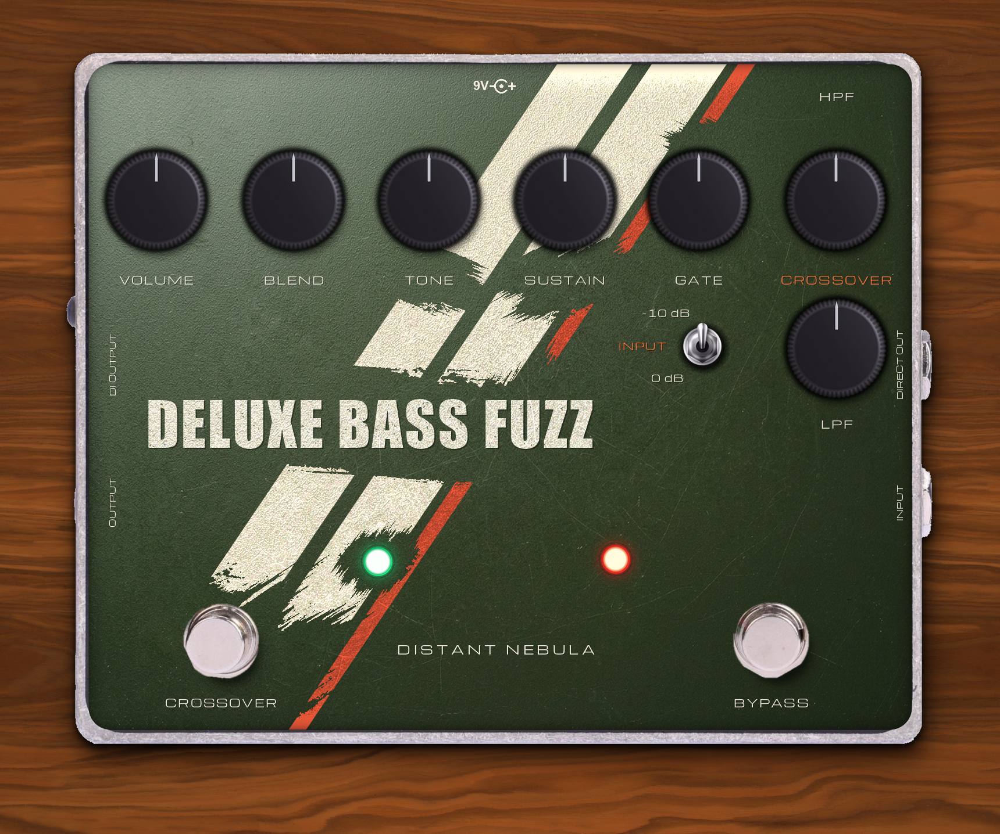

# Deluxe Bass Fuzz

Open-source JUCE VST3/CLAP/AU/Standalone plugin by **Distant Nebula**, inspired by a tasty classic bass fuzz with a parallel crossover network, clean blend, noise gate, and input pad.



## Features

- **Full white-box circuit modeling** of the 4-transistor Classic Bass Fuzz core (4-transistor bass fuzz topology)
- **Circuit-simulated gain stages**: each of Q1-Q4 is a small nodal/state-space model of the real parts (2N5088 Ebers-Moll + Early effect, 1N914 diode pairs in series with 47n in the feedback loop), solved with Newton per sample; validated against ngspice (`docs/validation.md`)
- **White-box tone stack**: 11.5k/10n low-pass (~1.38 kHz, value per circuit reference for the Deluxe Bass Fuzz) and 3n9/22k high-pass (~1.86 kHz) blended by the 100k pot, loaded by Q4
- **4× oversampling** around nonlinear stages
- **Deluxe features**: Blend, Crossover (HPF/LPF), Noise Gate, -10 dB Input Pad
- **VST3, AU, and Standalone** formats

## Controls

| Control | Range | Description |
|---------|-------|-------------|
| **SUSTAIN** | 0–100% | Log-taper attenuator between Q1 and the clipping stages (Q2, Q3) |
| **TONE** | 0–100% | Passive mid-scoop tone stack (bass ↔ treble) |
| **VOLUME** | 0–100% | Output level (log taper) |
| **BLEND** | 0–100% | Dry/wet mix (constant-power) |
| **GATE** | 0–100% | Noise gate threshold on fuzz path |
| **HPF** | 125–1750 Hz | Crossover high-pass on fuzz path |
| **LPF** | 60–10000 Hz | Crossover low-pass on dry path |
| **CROSSOVER** | On/Off | Engages crossover filters |
| **-10dB PAD** | On/Off | Input attenuation for active pickups |
| **BYPASS** | On/Off | True bypass |

## Signal Flow

```
Input → [Pad] → [Xover HPF] → Q1 → Q2(clip) → Q3(clip) → Tone Stack → Q4 → [Gate] ┐
                                                                                 ├──→ [Blend] → Output
Input → [Pad] → [Xover LPF] ─────────────────────────────────────────────────────┘
```

## Building

### Prerequisites (Windows, as tested)
- Visual Studio 2026 (v18) with the "Desktop development with C++" workload (MSVC 14.5x, Windows SDK 10.0.26100)
- CMake 4.x (needs the `Visual Studio 18 2026` generator; 4.4.4 tested)
- Git (JUCE is a submodule; GoogleTest v1.14.0 is fetched at configure time)
- Optional: [pluginval](https://github.com/Tracktion/pluginval/releases) for plugin validation

JUCE 8.0.17-security is pinned as a git submodule at `./JUCE`:

```powershell
git submodule update --init --recursive
```

### Build and test (PowerShell)

```powershell
# Configure (fresh build dir)
cmake -S . -B build-vs -G "Visual Studio 18 2026" -A x64

# Build plugin (VST3 + Standalone) and unit tests
cmake --build build-vs --config Release --parallel
cmake --build build-vs --config Debug --parallel   # optional

# Run unit tests
ctest --test-dir build-vs -C Release --output-on-failure

# Validate the VST3 (pluginval unpacked to C:\Users\<you>\tools\pluginval)
& "$env:USERPROFILE\tools\pluginval\pluginval.exe" --strictness-level 5 --validate-in-process `
    --validate "build-vs\DeluxeBassFuzz_artefacts\Release\VST3\DeluxeBassFuzz.vst3"
```

Or run the helper, which does all of the above: `.\build.ps1` (options: `-Config Debug`, `-Clean`, `-SkipTests`, `-SkipPluginval`).

### SPICE-vs-DSP validation

Reference circuit: `docs/deluxe_bass_fuzz.cir` (full deck) and `tests/ReferenceData/spice/bmp_parts.lib` (subcircuits used by the scripted runs).

Extra prerequisites: Python 3 with `pip install --user numpy scipy matplotlib`; optional [ngspice](https://ngspice.sourceforge.io/) (portable build, e.g. unpacked to `%USERPROFILE%\tools\ngspice`) only if you want to regenerate the SPICE reference data.

```powershell
.\build.ps1 -Validate               # render DSP, compare with committed SPICE data, plots + docs/validation.md
.\build.ps1 -Validate -RerunSpice   # also regenerate tests/ReferenceData/spice with ngspice first

# or step by step
python tools\run_spice.py                                                   # ngspice -> tests/ReferenceData/spice/*.csv
build-vs\DeluxeBassFuzzRender_artefacts\Release\DeluxeBassFuzzRender.exe --root .   # DSP -> tests/ReferenceData/dsp/*.csv
python tools\compare_spice.py                                               # docs/validation/*.png, docs/validation.md
ctest --test-dir build-vs -C Release -L validation --output-on-failure      # pass/fail checks
```

The default `ctest`/`build.ps1` run excludes the `validation` label. All validation checks (tone stack, each stage and the full core, AC and transient/THD) currently pass at their targets (see `docs/validation.md`).
### Outputs
- **VST3**: `build-vs/DeluxeBassFuzz_artefacts/Release/VST3/DeluxeBassFuzz.vst3` (copy to `C:\Program Files\Common Files\VST3` to use in a DAW; needs admin)
- **Standalone**: `build-vs/DeluxeBassFuzz_artefacts/Release/Standalone/DeluxeBassFuzz.exe`
- **Tests**: `build-vs/DeluxeBassFuzzTests_artefacts/Release/DeluxeBassFuzzTests.exe`
- **AU** (macOS only): `.../AU/DeluxeBassFuzz.component`
## Project Structure

```
DeluxeBassFuzz/
├── CMakeLists.txt
├── README.md
├── PLAN.md                 # Implementation plan
├── Source/
│   ├── PluginProcessor.h/.cpp
│   ├── PluginEditor.h/.cpp
│   └── dsp/
│       ├── InputPad.h/.cpp
│       ├── NonlinearCircuit.h        # MNA -> state-space circuit engine (Newton on junctions)
│       ├── BmpCircuit.h              # part values + shared stage-building helpers
│       ├── BmpInputStage.h/.cpp      # Q1 + SUSTAIN pot
│       ├── DiodeClipper.h/.cpp       # Newton-Raphson diode pair + ADAA (unit-tested, not used by the circuit stages)
│       ├── BmpClippingStage.h/.cpp
│       ├── BmpToneStack.h/.cpp       # Nodal analysis + bilinear transform
│       ├── BmpOutputStage.h/.cpp
│       ├── CrossoverFilters.h/.cpp
│       ├── NoiseGate.h/.cpp
│       ├── Blend.h/.cpp
│       └── Oversampler.h/.cpp
├── tests/
│   ├── ToneStackTest.cpp
│   ├── DiodeClipperTest.cpp
│   └── StageTest.cpp         # DC points vs SPICE, robustness, knob changes
└── docs/
    ├── circuit-notes.md      # Schematic transcription
    ├── deluxe_bass_fuzz.cir     # SPICE netlist (LTspice/QSPICE)
    └── validation.md         # Validation plan
```

## Modeling References

- circuit reference — [Classic Bass Fuzz History Part 2](http://www.kitrae.net/music/) (classic bass fuzz)
- circuit reference — [Classic Bass Fuzz History Part 3](http://www.kitrae.net/music/) (Deluxe Bass Fuzz)
- Jorge Pais — [The Fuzzler Delete](https://jorge-pais.github.io/articles/2022/03/10/The-Fuzzler-Delete/) (Stage analysis)
- NTUA Thesis — [Digital Simulation of Audio Circuits](https://dspace.lib.ntua.gr/xmlui/handle/123456789/53137) (NK method)
- Aalto — [White-box Modeling](https://aaltodoc.aalto.fi/server/api/core/bitstreams/4b830300-a5d6-4544-a0fa-a6f2ea123a5e/content) (Tone stack MNA)

## License

Proprietary / Educational. Based on publicly available circuit analysis.