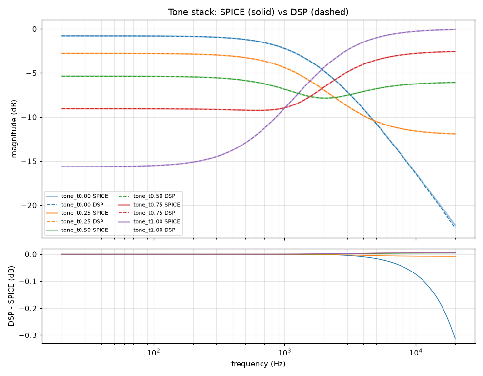
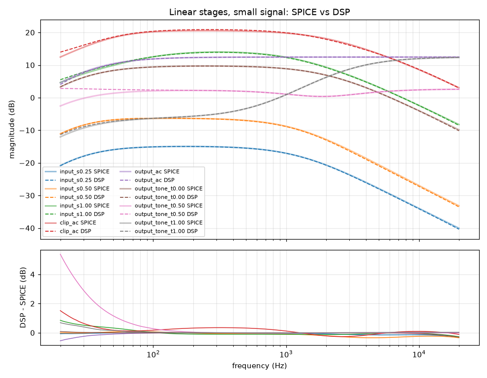
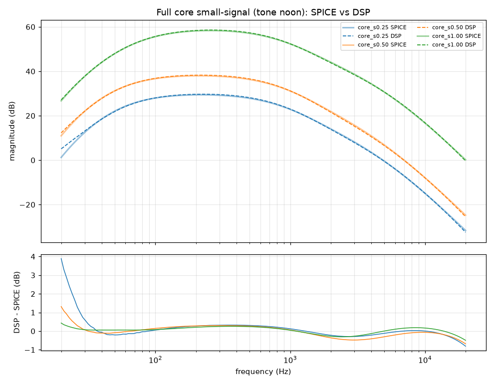
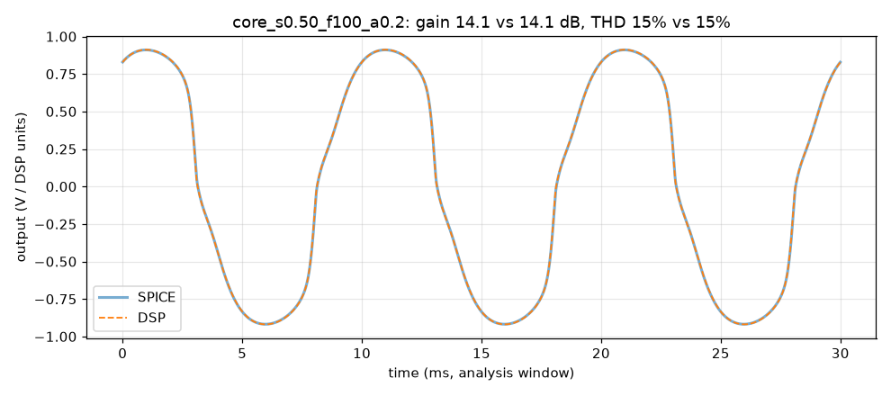
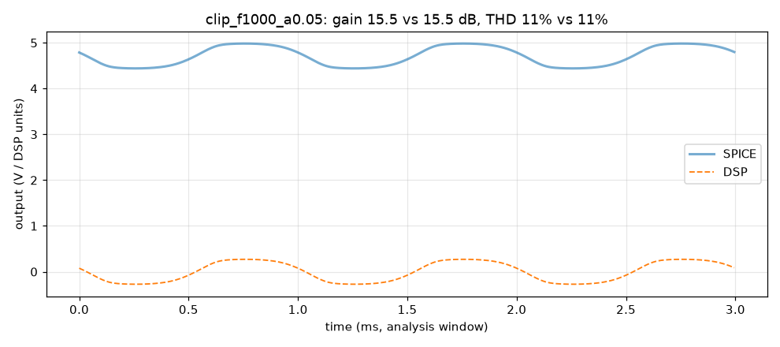
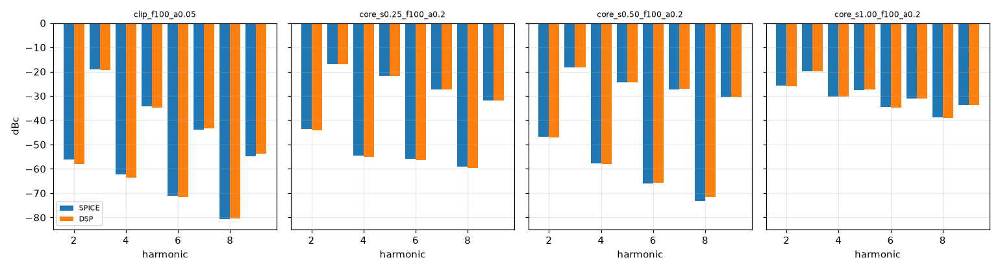
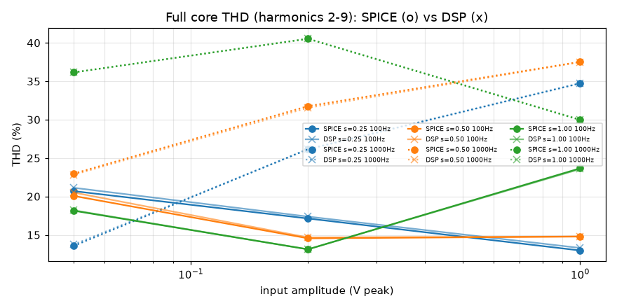

# Validation: DeluxeBassFuzz DSP Model

This document details the validation of the **DeluxeBassFuzz** DSP model against ngspice reference simulations.

## Model Architecture

The Q1–Q4 stages are circuit simulations of the discrete analog parts (see `docs/circuit-notes.md`, "DSP Model"), each loaded identically to the corresponding SPICE block. Every validation check passes within tolerance (tone 1 dB, AC 3 dB, transient gain 2 dB / THD 3 dB). Even harmonics arise naturally from the transistor bias point and unequal collector swing limits, and 4× oversampling controls aliasing around the stateful feedback clipping loop.

<!-- AUTO-GENERATED by tools/compare_spice.py: do not edit between these markers -->
## SPICE vs DSP results

Reference: ngspice 47 decks generated by `tools/run_spice.py` from `tests/ReferenceData/spice/bmp_parts.lib` (2N5088 / 1N914 models). DSP: `DeluxeBassFuzzRender` running the plugin's DSP blocks at 192 kHz. AC = small-signal magnitude; DSP side from a 1e-6 impulse response. Transient = last 100 ms of a 200 ms sine; harmonics 2-9 (floored at -100 dBc; harmonic deltas only scored where either side is above -60 dBc). THD above 100% means the harmonics are larger than the fundamental.

### Checks

| check | verdict | worst | tolerance |
|---|---|---|---|
| tone | PASS | 0.31 dB max error | 1.0 dB |
| input_ac | PASS | 0.34 dB max error | 3.0 dB |
| clip_ac | PASS | 0.35 dB max error | 3.0 dB |
| output_ac | PASS | 1.15 dB max error | 3.0 dB |
| core_ac | PASS | 0.48 dB max error | 3.0 dB |
| clip_tran | PASS | gain 0.1 dB, THD 2.0 dB | 2.0 dB / 3.0 dB |
| core_tran | PASS | gain 0.1 dB, THD 0.2 dB | 2.0 dB / 3.0 dB |

### Small-signal magnitude error (DSP - SPICE)

Band: 20 Hz-20 kHz for the tone stack, 50 Hz-10 kHz otherwise. *Offset* = mean error (gain mismatch); *shape* = max error after removing the offset.

| case | max abs (dB) | mean abs (dB) | offset (dB) | shape max (dB) | SPICE @1k | DSP @1k |
|---|---|---|---|---|---|---|
| tone_t0.00 | 0.31 | 0.02 | -0.02 | 0.29 | -2.2 | -2.2 |
| tone_t0.25 | 0.01 | 0.00 | -0.00 | 0.01 | -4.4 | -4.4 |
| tone_t0.50 | 0.00 | 0.00 | +0.00 | 0.00 | -6.9 | -6.9 |
| tone_t0.75 | 0.00 | 0.00 | +0.00 | 0.00 | -9.0 | -9.0 |
| tone_t1.00 | 0.00 | 0.00 | +0.00 | 0.00 | -9.0 | -9.0 |
| input_s0.25 | 0.15 | 0.06 | -0.05 | 0.10 | -17.0 | -17.1 |
| input_s0.50 | 0.34 | 0.14 | -0.11 | 0.23 | -8.8 | -8.9 |
| input_s1.00 | 0.32 | 0.09 | -0.05 | 0.37 | 12.4 | 12.3 |
| clip_ac | 0.35 | 0.20 | +0.11 | 0.37 | 19.8 | 19.9 |
| output_ac | 0.09 | 0.01 | -0.00 | 0.09 | 12.4 | 12.4 |
| output_tone_t0.00 | 0.05 | 0.01 | -0.00 | 0.05 | 8.9 | 8.9 |
| output_tone_t0.50 | 1.15 | 0.11 | +0.10 | 1.06 | 1.1 | 1.1 |
| output_tone_t1.00 | 0.16 | 0.02 | +0.02 | 0.13 | 0.9 | 0.9 |
| core_s0.25 | 0.32 | 0.18 | +0.04 | 0.34 | 22.9 | 23.0 |
| core_s0.50 | 0.48 | 0.23 | -0.01 | 0.47 | 31.1 | 31.2 |
| core_s1.00 | 0.31 | 0.16 | +0.05 | 0.36 | 52.3 | 52.4 |

### Transient (fundamental gain, THD, harmonics)

| case | gain SPICE | gain DSP | delta | THD SPICE | THD DSP | THD delta | max harmonic delta (H2-H9 above -60 dBc) | waveform RMS err |
|---|---|---|---|---|---|---|---|---|
| clip_f100_a0.01 | 20.1 dB | 20.1 dB | +0.0 | 1.3% | 1.6% | +2.0 dB | -4.1 dB (H9) | 0.01 |
| clip_f100_a0.05 | 15.8 dB | 15.8 dB | +0.0 | 11.2% | 11.1% | -0.1 dB | -1.7 dB (H2) | 0.00 |
| clip_f100_a0.2 | 8.0 dB | 8.0 dB | +0.0 | 20.4% | 20.5% | +0.0 dB | -1.7 dB (H6) | 0.00 |
| clip_f1000_a0.01 | 18.7 dB | 18.7 dB | +0.1 | 2.4% | 1.9% | -1.8 dB | -3.6 dB (H2) | 0.01 |
| clip_f1000_a0.05 | 15.5 dB | 15.5 dB | +0.0 | 10.7% | 10.6% | -0.1 dB | -1.1 dB (H4) | 0.01 |
| clip_f1000_a0.2 | 6.8 dB | 6.8 dB | +0.0 | 26.0% | 25.9% | -0.0 dB | -0.6 dB (H6) | 0.00 |
| core_s0.25_f100_a0.05 | 19.7 dB | 19.7 dB | +0.0 | 20.7% | 21.1% | +0.2 dB | -1.5 dB (H2) | 0.00 |
| core_s0.25_f100_a0.2 | 11.6 dB | 11.6 dB | -0.0 | 17.1% | 17.4% | +0.1 dB | -0.6 dB (H2) | 0.00 |
| core_s0.25_f100_a1 | 0.5 dB | 0.5 dB | -0.0 | 13.0% | 13.3% | +0.2 dB | +0.6 dB (H8) | 0.00 |
| core_s0.25_f1000_a0.05 | 17.8 dB | 17.8 dB | -0.0 | 13.6% | 13.7% | +0.1 dB | +0.2 dB (H5) | 0.01 |
| core_s0.25_f1000_a0.2 | 8.2 dB | 8.2 dB | -0.0 | 26.2% | 26.1% | -0.0 dB | -0.5 dB (H2) | 0.01 |
| core_s0.25_f1000_a1 | -4.8 dB | -4.8 dB | -0.0 | 34.7% | 34.7% | -0.0 dB | +0.1 dB (H2) | 0.00 |
| core_s0.50_f100_a0.05 | 22.5 dB | 22.5 dB | +0.0 | 20.1% | 20.5% | +0.2 dB | +0.5 dB (H9) | 0.01 |
| core_s0.50_f100_a0.2 | 14.1 dB | 14.1 dB | +0.0 | 14.6% | 14.7% | +0.1 dB | -0.3 dB (H2) | 0.00 |
| core_s0.50_f100_a1 | 4.0 dB | 4.0 dB | +0.0 | 14.8% | 14.8% | +0.0 dB | -0.2 dB (H2) | 0.01 |
| core_s0.50_f1000_a0.05 | 19.7 dB | 19.6 dB | -0.1 | 23.0% | 22.8% | -0.1 dB | -0.4 dB (H2) | 0.01 |
| core_s0.50_f1000_a0.2 | 8.9 dB | 8.9 dB | -0.0 | 31.8% | 31.5% | -0.1 dB | -0.1 dB (H9) | 0.01 |
| core_s0.50_f1000_a1 | -4.7 dB | -4.7 dB | -0.0 | 37.5% | 37.5% | -0.0 dB | -0.0 dB (H9) | 0.01 |
| core_s1.00_f100_a0.05 | 27.5 dB | 27.5 dB | -0.0 | 18.1% | 18.2% | +0.0 dB | -0.4 dB (H2) | 0.00 |
| core_s1.00_f100_a0.2 | 20.5 dB | 20.5 dB | -0.0 | 13.1% | 13.1% | -0.0 dB | -0.2 dB (H2) | 0.00 |
| core_s1.00_f100_a1 | 10.6 dB | 10.6 dB | -0.0 | 23.7% | 23.6% | -0.0 dB | -2.8 dB (H4) | 0.01 |
| core_s1.00_f1000_a0.05 | 21.3 dB | 21.3 dB | -0.0 | 36.1% | 36.1% | -0.0 dB | +0.2 dB (H6) | 0.04 |
| core_s1.00_f1000_a0.2 | 9.1 dB | 9.1 dB | -0.0 | 40.5% | 40.6% | +0.0 dB | -0.7 dB (H8) | 0.03 |
| core_s1.00_f1000_a1 | -3.9 dB | -4.0 dB | -0.0 | 30.0% | 30.0% | +0.0 dB | +0.5 dB (H2) | 0.03 |

### Plots

<!-- END AUTO-GENERATED -->
